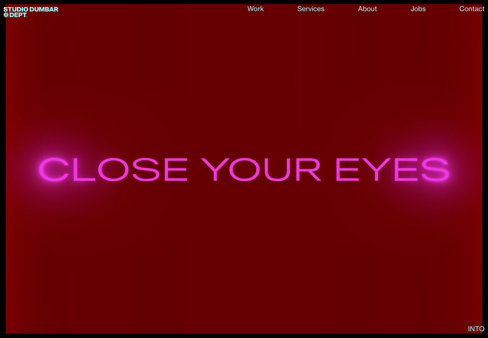
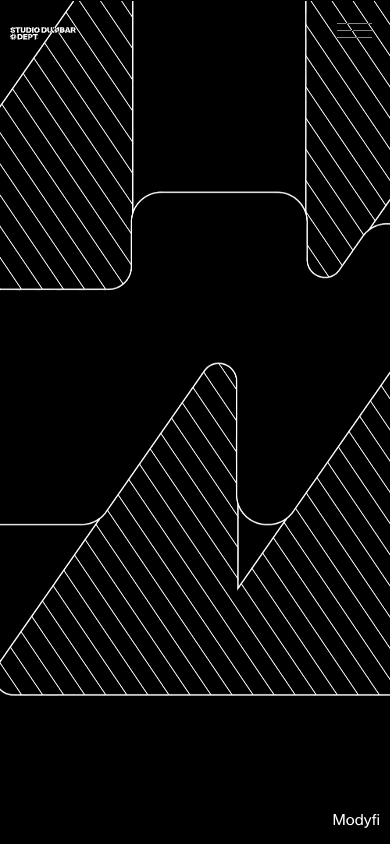
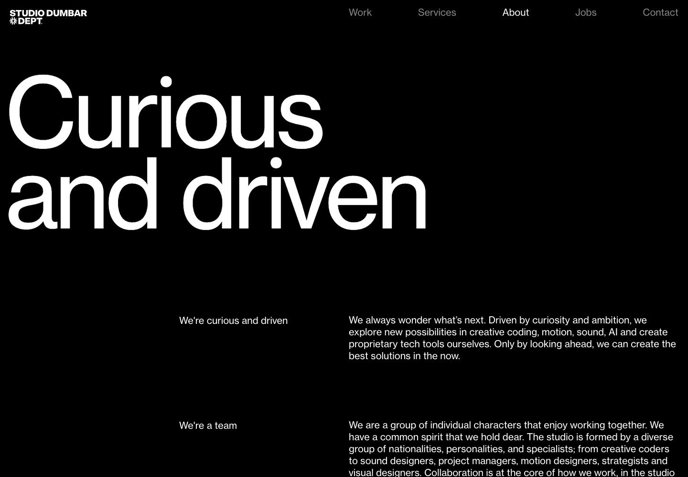

# Studio Dumbar reference and Armand Demulder design brief

Studied on 2026-11-12 using the live website, desktop and mobile browser screenshots, computed styles, public CSS and homepage scroll configuration.
This file lives outside `www/` so future agents can recover the design direction without adding research material to the published site.
The user explicitly selected Studio Dumbar's look and feel and Inter Tight Regular.
This brief supersedes the earlier scaffold-only restriction in `www/AGENTS.md`.

## Sources and evidence

- [Studio Dumbar home](https://studiodumbar.com/)
- [Studio Dumbar about](https://studiodumbar.com/about)
- [Studio Dumbar project example](https://studiodumbar.com/work/into)
- [Public reference stylesheet](https://studiodumbar.com/assets/css/main.css?v=124)
- [Inter Tight on Google Fonts](https://fonts.google.com/specimen/Inter+Tight)
- [Google Fonts family metadata](https://github.com/google/fonts/blob/main/ofl/intertight/METADATA.pb)
- [Inter Tight font license](https://github.com/google/fonts/blob/main/ofl/intertight/OFL.txt)
- [Pyotr selected-projects scroll reference](https://its-pyotr.com/selected/)
- [Pyotr native infinite-scroll source, inspected commit](https://github.com/woshibide/wshbd/blob/8f87e667f27273d3a3afe610288ab2235118bc8d/src/scripts/selected-scroll.js)

Local screenshots are observations of the reference, not artwork for Armand's site.
The reference homepage changes its starting project and contains moving media, so project imagery will differ between visits.







## Observed reference system

The base canvas is black, with white foreground and gray inactive navigation.
Project media supplies the color.
There are no card surfaces, rounded panels or centered marketing containers.
The desktop header stays fixed over the work, with identity at the left and navigation across the right half.
At 1440px width, the outer gutter is approximately 10px and the header starts approximately 15px from the top.
Measured UI type is Haas Regular at 20px with 24px body line height and 20px navigation line height.
UI type scales down to approximately 15px on mobile.
Project names sit near the bottom-right edge, approximately 10px horizontally and 12px vertically.
The homepage has no footer.
Its infinite scroll uses Lenis and GSAP, with overlapping full-screen media and velocity-dependent scaling.
About uses oversized regular typography, tight tracking, generous black space and smaller supporting text.
The reference has a mobile menu because it has more navigation destinations.

These are measured observations, not a requirement to reproduce the reference's implementation or proprietary assets.

## Armand's accepted direction

Subject: Armand Demulder's personal portfolio.
Audience: people browsing his work and potential collaborators.
The homepage's job is to let projects occupy the screen and lead into individual project pages.
The signature is a sequence of viewport-sized crossed rectangles until real project artwork is supplied.
The user's chosen reference takes precedence over avoiding familiar black-and-white design patterns.

Keep the reference's full-bleed composition, quiet navigation, edge alignment and typographic restraint.
Use Armand's name, content and artwork rather than the reference's identity, project images or writing.
Use a single regular font family as requested, rather than adding a second display face.
Use native scrolling and CSS snapping rather than importing the reference's animation libraries.
Preserve infinite scrolling in both directions, using the user's supplied Pyotr reference for interaction.
The reference is CSS-first: CSS owns snapping, while JavaScript recycles groups in reserved native scroll space.
Do not restore per-cycle jumps, JavaScript smoothing or custom wheel/keyboard handlers.
Do not add autoplay, a custom cursor, entrance animations, velocity scaling, decorative gradients or page-transition effects.

## Design tokens

Define tokens in `www/assets/css/main.css` rather than scattering values through selectors.
The user's sentence about base CSS variables was unfinished, so the initial token set covers colors, typography, spacing, viewport size and motion.

| Token | Initial value | Purpose |
| --- | --- | --- |
| `--color-background` | `#000000` | Main canvas. |
| `--color-foreground` | `#ffffff` | Text and active links. |
| `--color-muted` | `#999999` | Inactive text with readable contrast. |
| `--color-line` | `#444444` | Placeholder strokes and understated separators. |
| `--font-body` | `Inter Tight`, Arial, sans-serif | All typography, weight 400 only. |
| `--font-size-ui` | Fluid 15px to 20px | Header, project captions, position labels and footer. |
| `--font-size-display` | Fluid 52px to 160px | About statement and project titles. |
| `--line-height-body` | `1.2` | UI and prose. |
| `--line-height-display` | `0.98` | Oversized statements. |
| `--tracking-display` | `-0.045em` | Large type only. |
| `--space-edge` | `10px` | Shared horizontal alignment. |
| `--space-header` | `15px` | Header's desktop vertical inset. |
| `--space-content` | Fluid 100px to 160px | Clear content below the fixed header. |
| `--viewport-height` | `100vh`, upgraded to `100dvh` | Full visible viewport, including mobile browser chrome changes. |

Use safe-area insets in addition to the edge spacing on devices with notches.
Do not introduce synthetic bold or italic styles.

## Layout

Desktop shell:

```text
Armand Demulder                                                    About

                        full-screen project artwork
                      rectangle with corner-to-corner X

01 / 03                                                     Project one
```

The name is a home link.
About links to `/about` and stays aligned to the right edge.
There is no Work link or mobile menu.
Use comfortable touch targets even though the visible type stays small.

## Homepage behavior

- Each project occupies the full viewport width and height, with no gaps or outer content padding.
- Use one SVG crossed rectangle asset with non-scaling strokes and corners that meet the viewport edges.
- Preserve the three existing placeholder project records and their individual URLs.
- Each frame links to its project, with its title at the bottom right.
- Keep the page heading available to assistive technology without making it a visual hero.
- Hide the shared footer on home, including the no-JavaScript fallback.
- Apply CSS `scroll-snap-type: y mandatory` to the home main element, with `scroll-snap-align: start` on each frame.
- Use `scroll-snap-stop: normal` to preserve momentum and allow larger gestures to pass intermediate projects.
- Keep project groups and spacer blocks in native scrolling flow, with a static position label per frame at the bottom left.
- Materialize the current project group and its neighbors, exchanging offscreen groups and spacer heights without moving surviving content.
- Keep inactive groups out of the tab order and accessibility tree, retaining a focused group's context until it is retired.
- Use native wheel, touch, trackpad and keyboard navigation.
- With JavaScript disabled, retain the finite CSS-snapping list and project links.
- Repeat the sequence indefinitely in both directions, without arrow controls or per-cycle teleports.
- Preserve the logical project position on resize and orientation changes.
- An empty collection needs a readable full-height empty state; a single project still fills the viewport.

## Infinite-scroll implementation reference

The user supplied [Pyotr's selected-projects page](https://its-pyotr.com/selected/) and [its repository](https://github.com/woshibide/wshbd) as the interaction reference.
Inspected commit: `8f87e667f27273d3a3afe610288ab2235118bc8d`, dated 2026-11-03.
The relevant sources are [`src/scripts/selected-scroll.js`](https://github.com/woshibide/wshbd/blob/8f87e667f27273d3a3afe610288ab2235118bc8d/src/scripts/selected-scroll.js) and [`src/styles/selected.css`](https://github.com/woshibide/wshbd/blob/8f87e667f27273d3a3afe610288ab2235118bc8d/src/styles/selected.css).

The reference uses CSS snapping with a JavaScript helper, rather than a CSS-only loop.
It reserves approximately eight million pixels of native scroll space and starts near the middle.
Spacer blocks represent unrendered cycles, while nearby project groups are created and retired without changing surviving content's coordinates.
Normal wheel and touch input never writes the scroll position.
It preserves the touched group until the gesture ends and recenters only near the remote range limits after input has stopped.

Armand's implementation follows that pattern in `www/assets/js/main.js`, using the home `main` element as the native scroll container.
The current cycle and its neighbors are materialized, normally nine frames for the three-project portfolio.
Only the active cycle remains in the accessibility tree and tab order, with an exception for retained keyboard focus.
The adaptation keeps `scroll-snap-stop: normal` to preserve larger gestures and retains all existing project links.
Scroll-position writes are limited to initial range setup, logical-position restoration on resize and idle recovery near the distant endpoints.
Do not replace this with short-range sentinel jumps at every project-cycle boundary.

## Inner pages and content

About uses an oversized left-aligned statement, normal case, regular weight and tight line spacing.
Use the user's exact copy:

> Armand is a jolly french man with a big heart.
> Bissous bissous

Keep the About heading in the document hierarchy without placing a second competing visual headline above the statement.
Project pages use the same header, oversized title, quieter metadata and story, and a large crossed rectangle when no cover exists.
Existing cover, gallery, story, metadata and previous/next project functionality must remain editable through Kirby.

The footer appears on about, project and utility pages.
Its wording is “Website was last updated [DD.MM.YYYY], Armand Demulder forever”.
Render the date inside a semantic `time` element.
CI supplies the latest commit timestamp through `SITE_UPDATED_AT`; local fallback uses published content and asset modification times.
Format the date in the Europe/Amsterdam timezone.
Do not put a footer in the homepage DOM.

## Font delivery

The downloaded font is Google's regular, upright, 400-weight Inter Tight Latin WOFF2, approximately 22KB.
Store it at `www/assets/fonts/inter-tight-regular.woff2` with the original `OFL.txt` beside it.
Use a local `@font-face`, `font-display: swap`, a matching preload and `font-synthesis: none`.
Do not load a Google Fonts stylesheet or make third-party font requests at runtime.
Add another language subset only when the content requires it.

## Verification checklist

1. Inspect desktop, mobile and inner-page screenshots against the reference's structure.
2. Verify each original frame matches the viewport exactly, with no horizontal overflow or footer.
3. Scroll through several complete forward/backward cycles and check idle recovery near remote range limits.
4. Check larger wheel gestures, touch, native keyboard input, focus visibility and resizing.
5. Sample viewport coverage and DOM size during continuous scrolling, and assert zero scroll-position writes during wheel/touch input.
6. Verify reduced motion, JavaScript-disabled navigation and zero/one-project states.
7. Check exact About copy, footer wording, date format and absence of the home footer.
8. Run `composer build` and `composer check`, including a repository-subpath build and real static-browser navigation.
9. Confirm the font is loaded locally, SVG assets export correctly and no external runtime dependencies were introduced.

## Implementation verification on 2026-11-12

The browser regression suite covers infinite CSS-snapping cycles on desktop/mobile, continuous wheel momentum, bounded DOM, blank-frame prevention and idle range recovery.
It asserts zero scroll writes during ordinary wheel/touch input and also checks keyboard input, resize, reduced motion, header links and the JavaScript-disabled finite fallback.
The updated suite passed 20 checks, with two desktop-only touch cases intentionally skipped and covered by the mobile project.
Resize followed by further scrolling also passed six repeated desktop/mobile checks.
Real Kirby zero/one-project variants were rendered and checked in a mobile browser.
The adjusted Home blueprint and exact About copy were verified through the local Panel UI and authenticated API.
A real static browser check under `/portfolio/` verified navigation, the local font, SVG delivery and conversion of a 23:30 UTC update timestamp to the next day in Amsterdam.
Composer build, artifact checks and configuration validation passed.
The project is pushed to [woshibide/armand](https://github.com/woshibide/armand), with website source in `www/` and the workflow at the repository root.
GitHub Pages must use the GitHub Actions publishing source.
The Kirby runtime also has a fortrabbit app at [armand.frbit.cloud](https://armand.frbit.cloud); hosting and content-sync details live in `www/README.md`.
